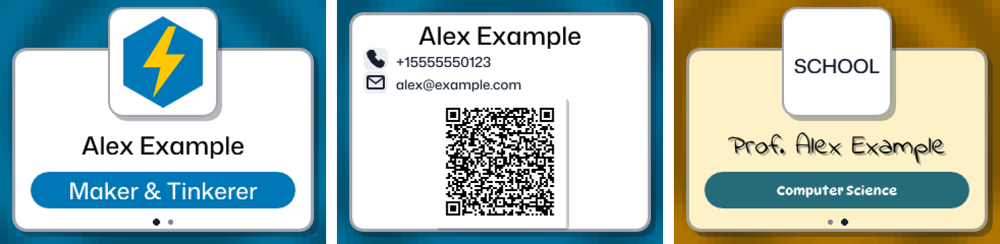
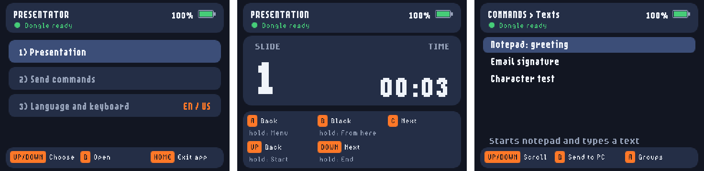
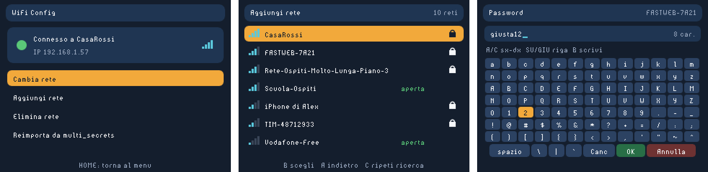

# tufty2350-apps

A small collection of apps for the [Pimoroni Tufty 2350](https://shop.pimoroni.com/products/tufty-2350)
badge (RP2350, 320×240 colour display, WiFi + Bluetooth, MicroPython "Badgeware" firmware),
plus an ESP32-S3 USB dongle and a 3D-printable case that turn the badge into a wireless
presentation remote.

Everything was built as a maker side project and used day to day at school and at work.
The Presentator speaks **English and Italian** (selectable on the badge); `wifi_config` and
`claude_monitor` show Italian texts, and some code comments are in Italian. The docs are in
English.

> **Featured on the Pimoroni blog:**
> [Tufty 2350 Powers Teacher's Presentation Controller](https://blog.pimoroni.com/tufty-2350-powers-teachers-presentation-controller/).
> `multi_badge`, `presentator` and `wifi_config` are also in Pimoroni's official
> [badgeware-contrib](https://github.com/pimoroni/badgeware-contrib/tree/main/Tufty) collection.

| App | What it does |
|---|---|
| [`multi_badge`](#multi_badge) | Multi-profile name badge. The back shows a vCard QR code for sharing your contact details. |
| [`presentator`](#presentator--presentator_dongle) | Slide remote and "macro keyboard" for a PC, through a tiny ESP32-S3 BLE→USB dongle. |
| [`wifi_config`](#wifi_config) | On-badge WiFi manager: scan, virtual keyboard, multiple saved networks. |
| [`claude_monitor`](#claude_monitor) | Shows your Claude plan usage (5-hour and weekly limits). **Unofficial**, read the warnings. |
| `font_viewer` | Browse the fonts bundled with the firmware at different sizes. |

---

## What you need

- A **Tufty 2350** running the official Badgeware MicroPython firmware. Tested with
  `bw-1.28.0-3`; see [pimoroni/tufty2350](https://github.com/pimoroni/tufty2350) for flashing
  and updates.
- For the Presentator only:
  - an **ESP32-S3** board with native USB. Tested on an *ESP32-S3 Supermini*; a
    *Seeed XIAO ESP32S3* is also supported.
  - [PlatformIO](https://platformio.org/);
  - optionally, a 3D printer for the case.
- For development without hardware: Python 3.10+, and optionally
  [Playwright](https://playwright.dev/python/) for the simulator tests.

## Install the apps on the badge

1. Put the Tufty in **Disk Mode**: it shows up as a USB drive.
2. Copy the folders you want from `apps/` into `apps/` on that drive. For example, `apps/multi_badge`
   goes to `<drive>:\apps\multi_badge`.

   The apps expect to live in `/system/apps/<name>`, so keep the folder names unchanged.
   `multi_badge` installs next to the firmware's own `badge` app and does not replace it.
3. Copy `secrets.example.py` to the **root** of the drive as `secrets.py`, then fill in your
   WiFi network, region and timezone. This step is only needed by `wifi_config` and
   `claude_monitor`.
4. Eject the drive and reset the badge. The new apps appear in the launcher.

### Personal files vs. examples

Your personal data never needs to be committed. Every app that needs personal data reads a
local file first and falls back to the example file shipped in this repo:

| Personal file (git-ignored) | Example (tracked) | Used by |
|---|---|---|
| `secrets.py` | `secrets.example.py` | WiFi, region, timezone, Claude Monitor label |
| `apps/multi_badge/badge.json` | `apps/multi_badge/badge.example.json` | badge profiles |
| `apps/multi_badge/assets/logos/*.png` | `apps/multi_badge/assets/logos/example.png` | badge logos |
| `apps/presentator/comandi.json` | `apps/presentator/comandi.example.json` (English) or `comandi.example.it.json` (Italian) | Presentator commands |
| `apps/presentator/chiave.txt` | generated by `presentator_dongle/tools/genera_chiave.py` | shared key with the dongle |

To customise an app, copy the example to the personal file name next to it and edit the
copy. The `.gitignore` already excludes the personal files.

---

## multi_badge



A name badge with any number of **profiles**: for example one for work, one for school and
one for a makerspace. Each profile has its own name, role, logo, fonts and colours.

| Button | Action |
|---|---|
| UP / DOWN | previous / next profile |
| B | flip the badge: the back shows phone, email and a **vCard QR code** |
| A / C (hold) | decrease / increase the background colour saturation |

Configuration lives in `badge.json`; start from `badge.example.json`.

- **Layout:** `config` holds the shared layout and transition settings.
- **Profiles:** each entry in `profiles` holds `NAME`, `ROLE`, `PHONE`, `EMAIL`, `COMPANY`,
  `WEBSITE`, `LOGO`, plus font and colour settings.
- **Logos:** transparent PNGs, scaled to fit 100×100 px. If a logo file is missing,
  `LOGO_LABEL` is shown as text instead (see `apps/multi_badge/assets/logos/README.txt`).
- **Fonts:** fonts such as `MonaSans-Medium.af` or `IndieFlower-Regular.af` come from the
  firmware (`/system/assets/fonts`) and are not part of this repo. Use the `font_viewer` app
  to see which ones you have.
- **QR cache:** QR codes are generated on the badge with [uQR](apps/multi_badge/uQR.py)
  (BSD licence, see `uQR_LICENSE.txt`) and cached in `/cache/multi_badge`.

## presentator + presentator_dongle



```
Tufty 2350 (Presentator app) --BLE--> ESP32-S3 dongle --USB HID keyboard--> PC
```

**Why a dongle?** The official firmware is built without BLE pairing support, so the badge
cannot present itself to the PC as a Bluetooth keyboard. The dongle avoids this: the PC sees
a plain USB keyboard, with no drivers or software to install, and the badge keeps the
official, updatable firmware.

- **Presentation mode:**
  - next and previous slide;
  - start the show (F5) or start from the current slide (Shift+F5);
  - end the show (Esc);
  - black screen;
  - slide counter and timer.
- **Commands mode:** a menu of websites, programs, text snippets, keyboard shortcuts and small
  macros, read from `comandi.json` (start from `comandi.example.json`, or from
  `comandi.example.it.json` for an Italian keyboard). Keys can be written in English
  (`groups`, `name`, `url`, `open`, `text`, `keys`, `steps`…) or Italian. The format is
  documented at the top of `apps/presentator/comandi.py`.
- **Language and keyboard** (third entry of the main menu, saved on the badge):
  - interface in **English** (default) or **Italian**;
  - the PC's keyboard layout: **US**, **UK** or **Italian**. The badge turns text into the
    right key codes for that layout. Use the plain US layout on the PC, not
    US-International: its dead keys garble `' " ` ~ ^`.
- **Security:**
  - every message is signed with HMAC-SHA256, using a key shared by the badge and the dongle;
  - each message also carries a per-connection nonce and a counter;
  - the dongle ignores forged, replayed or incomplete messages.

Languages and layouts live in the badge app only: updating from an older version needs **no
dongle reflash**.

### Adding a language

1. Copy `apps/presentator/lang/en.json` to `lang/<code>.json` (for example `de.json`) and
   translate the values. Keep the keys and the `%s` / `%d` placeholders as they are, and set
   `"_name"` to the language's own name (`"Deutsch"`): the new file shows up in the menu by
   itself. Missing keys fall back to English.
2. Run `python presentator_dongle/tools/test_badge.py`: it checks that every language file
   has the same keys and placeholders as `en.json`.
3. Check the screens in both languages with the simulator script below (long words can be
   cut short on the 320×240 display).

The display fonts cover Latin letters with accents; scripts such as Greek, Cyrillic or CJK
cannot be shown with the built-in fonts. Pull requests with new languages are welcome.

### Adding a keyboard layout

The tables are in `_TABELLE` in `apps/presentator/comandi.py`. On Windows,
`python presentator_dongle/tools/prova_tastiera.py confronta` checks every character of every
table against Windows' own layout definitions, and `prova_tastiera.py ricevi <layout>`
receives what the dongle really types and compares it with what it should.

Setup, building and flashing are covered in [`presentator_dongle/README.md`](presentator_dongle/README.md).
The printable case (STL, STEP and a parametric FreeCAD script) is described in
[`presentator_dongle/case/README.md`](presentator_dongle/case/README.md).

## wifi_config



The badge's WiFi manager:
- tries your known networks in order;
- lets you switch network, add one (scan plus an on-screen keyboard), delete one, or re-import
  the list from a file;
- keeps `secrets.py` in sync with the last network that worked, so the other apps only call
  `wifi.connect()`.

It also avoids a firmware behaviour where repeated failed connections reboot the badge.

Details: [`docs/wifi-config.md`](docs/wifi-config.md).

## claude_monitor

A dashboard showing your **Claude** subscription usage:
- the 5-hour session and weekly limits, with their reset times;
- extra-usage credits, if you have any.

You log in once: the badge serves a small web page on your LAN, you open it from a browser,
authorise on claude.com and paste the code back. After that the badge refreshes the token by
itself.

> [!WARNING]
> This app is **unofficial** and is not affiliated with or endorsed by Anthropic.
> - It reuses the public OAuth client of Claude Code and an **undocumented** usage endpoint.
>   Either can change or stop working at any time.
> - Check that this use is compatible with the terms of your Claude plan before using it.
> - Access and refresh tokens are stored **unencrypted** in the badge's internal storage.
> - During login the setup page (port 8080) has **no authentication**. Only run the login on a
>   network you trust.

Optional: set `CLAUDE_ACCOUNT_LABEL` in `secrets.py` to show a label, such as your account
email, in the corner of the dashboard.

---

## Developing without the badge

The `dev_checks/` scripts test the app logic with desktop CPython, with no hardware needed:

```sh
python dev_checks/check_wifi_config.py
python dev_checks/check_claude_oauth_client.py
python dev_checks/check_claude_oauth_helpers.py
python dev_checks/check_claude_oauth_poll_usage.py
python dev_checks/check_localtime.py
python dev_checks/check_login_server.py
python presentator_dongle/tools/test_badge.py
python presentator_dongle/tools/prova_tastiera.py confronta   # Windows only
```

The screens are tested in the official web simulator, [try.badgewa.re](https://try.badgewa.re/),
driven by Playwright. Each script uploads the app, injects a fake network or fake Bluetooth
dongle, presses the buttons and saves a pixel-exact PNG of every screen:

```sh
pip install playwright && playwright install chromium
PYTHONIOENCODING=utf-8 python dev_checks/simulatore_wifi/prova_wifi_config.py out_wifi
PYTHONIOENCODING=utf-8 python presentator_dongle/tools/simulatore/prova_simulatore.py out_presentator
```

The Presentator script runs every scenario in English and in Italian (file names start with
`en_` / `it_`).

The simulator needs a GPU-accelerated Chromium: the scripts already pass the right flags.
It can differ from the real display by a few pixels, so always confirm on the badge.

## Repository layout

```
apps/                 the badge apps (copy to /system/apps on the badge)
dev_checks/           desktop tests and simulator harnesses
docs/                 extra documentation and screenshots
presentator_dongle/   ESP32-S3 firmware (PlatformIO), tools, tests, 3D-printable case
secrets.example.py    template for the badge's secrets.py
```

## Licence

[MIT](LICENSE), except `apps/multi_badge/uQR.py`, which keeps its own BSD licence
(`apps/multi_badge/uQR_LICENSE.txt`). Fonts and the Badgeware firmware belong to Pimoroni and are
not included.
